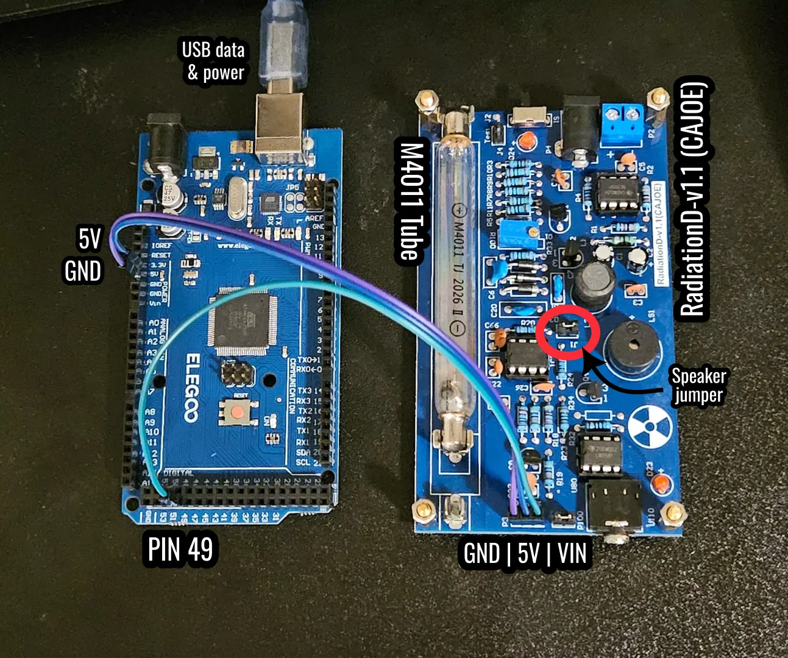
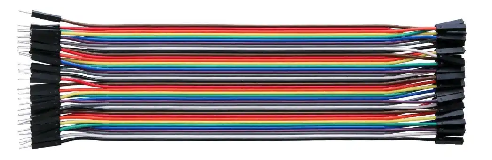

# Hardware Build

* [Bill of Materials](#bill-of-materials)
* [Wiring](#wiring)
* [Flashing Firmware](#flashing-firmware)
* [Arduino UNO](#arduino-uno)
* [More Pictures](#more-pictures)
* [Usage](./README.md)



[Video overview](https://youtu.be/PPCGsez5wok)
## Bill of Materials

* **Geiger Counter Kit** ~ $40 USD
  * It is labeled “**RadiationD-v1.1 (CAJOE) kit**” and comes with a few different tubes. I used the **M4011 tube** that came with mine. It is frequently available on AliExpress, [eBay](https://ebay.io/m/KHoTNR), and [Amazon](https://a.co/d/02xt5Qd4). The kit is often pre-assembled. .webp)
  * I didn’t attach the cover on mine since it prevents access to the pins.
* **Arduino Mega 2560 or UNO**
  * The included firmware supports both boards. The Mega was used for the sample captures; the UNO uses a different pulse-input pin, as described below.
  * The important thing is the board needs a **5V OUT** to power the Geiger Counter. So if you have a *Bill and Ted’s Excellent* micro-controller with 5V OUT and you know how to program it, then that will probably work too.
  * I frequently buy mine from Adafruit, Sparkfun, Digi-Key, ELEGOO, or Mouser, but I’m sure most brands/resellers should work.
  * An ESP32, Pi, or Pico would need a voltage divider or level shifter, e.g. 2 kΩ + 3.3 kΩ.
  * You will also need a USB connector to your computer based on whatever your board and computer requires.
* 3x **Male-Female Jumper Wires** 
  * These usually come in 40-wire bundles. My kit came with three, but they were the wrong style. I frequently buy ELEGOO brand, and that was what I had on hand, but most brands should work.
* *(Optional)* **Radioactive Source**
  * I tested an intact ionizing smoke detector and uranium glass. Never open or dismantle a smoke detector or remove its source. Follow the manufacturer's directions and your local rules for handling and disposal.
  * I got a small pouch of [uranium glass beads](https://a.co/d/0eXi3L45) on Amazon for $10. They were sold as *“Bohemia Crystal Valley Czech 50-Piece Glass Beads, 6x9mm, Teardrop Transparent Yellow Uranium Glass (Glows Under UV), Small”*
    * The indication that it *glows under UV* is a good sign that it is *real* uranium glass. I frequently encounter listings that claim to be “uranium glass” but really mean “uranium colored”; they will not glow and will not work.
  * Feel free to try other sources.
* *(Optional)* **Tube Upgrade** ~$50
  * I read that the SBM-20 Geiger-Muller Tube might be an upgrade, but it is a longer length, so it would require modification to the board.
  * I also read that the M4011 tube is the better of the two tubes that frequently come with the kit.
  * If you plan to upgrade, then you can sometimes find the [kit without a tube](https://a.co/d/0aGlxjXK) for less money.
  * Here is a [comparison of different tube options](https://radmon.org/index.php/forum/geiger-muller-tubes/1463-glass-tube-shootout).
  * Your mileage may vary, but it is an option.

The stronger the radiation source and the more sensitive the tube, the faster your system will gather entropy.

## Wiring

This powers the Geiger-counter via the Arduino and captures the events with timestamps.

| CAJOE header                         | Mega 2560       | UNO            |
| ------------------------------------ | --------------- | -------------- |
| `GND`                                | `GND`           | `GND`          |
| `5V`                                 | `5V`            | `5V`           |
| `VIN` (this is the **pulse output**) | pin 49 (`ICP4`) | pin 8 (`ICP1`) |

The pulse is 5 V logic, which both boards handle directly.

**Silencing the buzzer:** pull the jumper cap on `J1` (next to `R20`/`C66`). The buzzer stops clicking; the pulse output and the pulse LED (`D23`) are unaffected. Put the cap back to re-enable it.

## Flashing Firmware

The sketch `firmware/geiger_capture/geiger_capture.ino` timestamps every pulse with a hardware input-capture timer and streams `seq,ticks` over USB serial at 115200 baud. It selects Timer4/pin 49 for a Mega or Timer1/pin 8 for an UNO at compile time.

With [`arduino-cli`](https://arduino.github.io/arduino-cli/latest/installation/) (single binary; or `brew install arduino-cli`, or the install script on that page):

```
arduino-cli core update-index
arduino-cli core install arduino:avr            # one-time: AVR toolchain
arduino-cli board list                          # find the port, e.g. /dev/ttyACM0 (shows "Arduino Mega or Mega 2560")
arduino-cli compile --fqbn arduino:avr:mega firmware/geiger_capture
arduino-cli upload  --fqbn arduino:avr:mega -p /dev/ttyACM0 firmware/geiger_capture
```

Or with the [Arduino IDE](https://www.arduino.cc/en/software): open the `.ino`, choose *Tools → Board → Arduino Mega or Mega 2560* and the port, then Upload. No extra libraries are needed.

### Arduino UNO

Only two changes are needed:

1. Connect the CAJOE `VIN` pulse output to UNO digital pin 8 instead of Mega pin 49. Keep `5V` and `GND` connected as shown above.
2. Compile and upload for the UNO:

```
arduino-cli compile --fqbn arduino:avr:uno firmware/geiger_capture
arduino-cli upload  --fqbn arduino:avr:uno -p /dev/ttyACM0 firmware/geiger_capture
```

In the Arduino IDE, choose *Tools → Board → Arduino Uno* instead. The Python commands are unchanged. The serial header will report `board=uno capture_pin=8` so you can confirm the correct firmware path was selected.

Notes:

- Elegoo and other clones usually work with the stock `arduino:avr:mega` target. Clones with a CH340 USB chip show up as `/dev/ttyUSB0` instead of `ttyACM0`.
- **Linux serial permission:** your user must be in the `dialout` group (Fedora/Debian: `sudo usermod -aG dialout $USER`, then log out and in). Fedora with ModemManager may briefly grab new ports; if uploads fail, retry or `sudo systemctl stop ModemManager`.
- Check it works: `arduino-cli monitor -p /dev/ttyACM0 -c baudrate=115200` should print a `# qrng-geiger` header with `tick_hz=2000000`, the board, capture pin, and edge; then `seq,ticks` lines as pulses arrive (and `# alive` every 10 s). Close the monitor before running `capture`.
- Serial speed, heartbeat interval, buffer size, timer prescaler, and capture edge are grouped under **User settings** at the top of the sketch. If you change `SERIAL_BAUD`, pass the same value to `qrng.py capture --baud` and to the serial monitor.

## More Pictures

Mega end: pin 49 goes to `VIN` on the CAJOE board.


Mega side: `5V` and `GND` go to `5V` and `GND` on the CAJOE board.


CAJOE connections:


