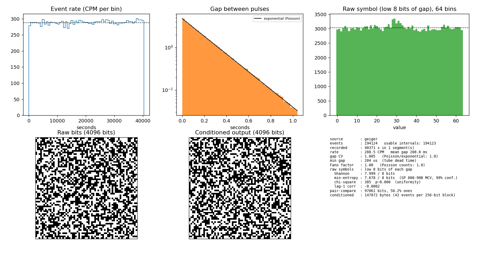

# Geiger-Counter Based QRNG

*Gather quantum entropy at home.*  

Uses the commonly available RadiationD-v1.1 (CAJOE) kit with the M4011 tube → Arduino Mega or UNO (hardware time-stamping) → Python (analysis + extraction). See [HARDWARE.md](./HARDWARE.md).



## Install the host tools

I ran this on Fedora Linux.

Python 3.9+ (developed on 3.14) with three packages from PyPI: [numpy](https://pypi.org/project/numpy/) (maths), [matplotlib](https://pypi.org/project/matplotlib/) (dashboard and figures), [pyserial](https://pypi.org/project/pyserial/) (talking to the Arduino). No SciPy needed.

```
python3 -m venv .venv && . .venv/bin/activate     # optional but tidy
pip install -r requirements.txt
```

If you'd rather use distro packages on Fedora: `sudo dnf install python3-numpy python3-matplotlib python3-pyserial`.
The live `dashboard` needs a GUI backend for matplotlib; if it complains, install Tk (`sudo dnf install python3-tkinter`, or `pip install PyQt6`). `analyze --png` needs no display.

## Use

`capture` finds the Arduino automatically (matching Arduino / CH340 / FTDI USB IDs, falling back to the first `/dev/ttyACM*` or `ttyUSB*`) and tells you which port it picked. If you have several boards attached, pass `--port /dev/ttyACM0`. Opening the port resets the board, so the first couple of seconds are lost on purpose; the file only contains post-reset data. It shows a rolling 60 s CPM while running.

```
./qrng.py capture                         # real hardware -> data/geiger-<time>.csv  (Ctrl-C to stop)
./qrng.py dashboard data/geiger-*.csv     # live view in a second terminal
./qrng.py analyze FILE --png out.png      # text report + figure
./qrng.py generate FILE -n 64             # 64 random BYTES (-n/--bytes, default 32) as hex; -o file.bin for binary
./qrng.py analyze FILE --full             # extra checks: Poisson fit, per-bit bias, autocorrelation, output tests
./qrng.py generate FILE --raw -o raw.bin  # unconditioned symbols for NIST ea_non_iid
```

See [Caveats](#caveats) for instructions on keeping your machine awake.

### Reports: png, hex, raw and markdown

When a `capture` ends (Ctrl-C) it writes four files next to the CSV, with the same base name:

| File | Contents |
|---|---|
| `NAME.png` | the analysis figure |
| `NAME.hex` | the conditioned random output, one 32-byte block (64 hex characters) per line |
| `NAME.raw` | the unconditioned symbols (low `k` bits of each gap, one per byte) |
| `NAME.md` | analysis report: flags, summary, detailed checks, SP 800-22 results, embedded figure |

`--no-report` skips this; `-k` and `--nist22 {none,out,raw,both}` control it (default `out`: SP 800-22 on the conditioned output). The CSV is closed and safe before the report starts, and a failure in the report never loses the capture.

The same thing can be run by hand, and across several captures:

```
./qrng.py report data/geiger-20261012-193342.csv --force             # regenerate (existing files are never overwritten without --force)
./qrng.py report data/geiger-2026101*.csv -o data/combined --nist22 both
```

The individual pieces are still available: `analyze --png/--full`, `generate`, and `nist22` below.

### NIST SP 800-22 test suite

[sp800_22_tests-py](https://github.com/jimmckeeth/sp800_22_tests-py) (a fork of [dj-on-github/sp800_22_tests](https://github.com/dj-on-github/sp800_22_tests); pure Python, GPL-2, no dependencies) is included as a git submodule:

```
git submodule update --init sp800_22_tests-py     # once, after cloning
./qrng.py nist22 data/geiger-*.csv                # conditioned output
./qrng.py nist22 data/geiger-*.csv --raw          # unconditioned low-k-bit symbols
```

`--suite PATH` or `$SP800_22_DIR` point at a different copy. Reports note when the suite is missing instead of failing.

It needs 1,028,016 bits (about 129 KB) for all 15 tests. `nist22` reports tests it can't run validly as `SKIPPED` (the suite itself calls some of them FAIL, and returns bogus P-values for the rank test below 38,912 bits), and skips the two random-excursion tests when the walk has fewer than 500 cycles. Its non-overlapping template test picks a single random template per call, so it is repeated 20 times and judged by proportion.
Roughly 177,000 events (~7.5 hours at 390 CPM) give that much conditioned output. The suite is pure Python but quick: about 30 s for 1 Mbit (plus ~1 min for the 20 repeated template draws).

### Combining captures

Each `capture` run writes its own file and never overwrites an existing one (`--force` to override). `analyze`, `generate` and `dashboard` accept any number of files and pool them:

```
./qrng.py analyze data/geiger-2026101*.csv --png all.png
./qrng.py generate data/geiger-*.csv -n 1024 -o random.bin
```

Runs are placed on one timeline by the `start=` time in each file's header, so breaks show as real gaps in the rate plot. Every run is a separate segment and no gap is ever measured across a break (a stopped run costs you one interval, nothing more), so pooling is statistically sound. Files from different tick rates are refused, and mixing in simulated data is flagged in red in the report.

### Simulation

No hardware handy (or a demo that must not stall)?

```
./qrng.py capture --simulate 30 --speed 100 -o data/sim.csv   # PRNG Poisson events, labelled SIMULATED, NOT quantum
./qrng.py capture --replay data/real-overnight.csv --speed 200 -o data/live.csv   # real data, sped up
```

## How it works

1. Each pulse is a decay event; gaps between pulses are exponentially distributed (the dashboard overlays the fit).
2. Low `k` bits (default 8) of each gap in 0.5 µs ticks are essentially uniform: the gap is seconds long, the low bits span ~128 µs.
3. Conditioning: SHA-256 over enough symbols to carry 256 + 64 bits of **measured** SP 800-90B MCV min-entropy per 256-bit block.
4. Also shown for teaching: the classic "compare two gaps" bit method (~1 bit per 3 events).

## Configuration

Common Python defaults—serial speed, tick rate, symbol width, output size, replay speed, dashboard refresh, entropy margin, and USB IDs—are grouped at the top of `qrng.py`. Firmware settings—serial speed, heartbeat interval, ring-buffer size, timer prescaler, and capture edge—are grouped under **User settings** at the top of `firmware/geiger_capture/geiger_capture.ino`.

Keep the firmware's `SERIAL_BAUD` and the host's `DEFAULT_SERIAL_BAUD` equal. The firmware writes its actual timer rate into every capture header, so the analysis automatically uses the selected board's rate.

## Caveats

- **Rate is the limit.** M4011 background is ~20–40 CPM → ~0.5 events/s → one 32-byte block per ~90 s. For a live demo, put a lawful, intact source near the tube (such as uranium glass or KCl salt substitute) to get a higher count rate. Do not dismantle smoke detectors or remove their sources. Record a long background run beforehand and use `--replay` as a fallback.
- The MCV estimate is a conservative single estimator; for serious claims run NIST's `ea_non_iid` on the `--raw` output, and `dieharder`/`rngtest` on the conditioned output.
- **Lost events are detected, not hidden.** The firmware numbers every pulse in the interrupt handler, so an event lost anywhere (ring overflow, serial, USB) leaves a gap in `seq`, and no interval is ever measured across it. For files without that guarantee, any gap longer than 20x the typical gap is also split out and reported as an `OUTAGE`.
- **Don't let the laptop sleep during a capture.** USB serial data is lost while it's suspended (a 168 s sleep once silently removed ~1,000 events). Inhibit sleep for the run, e.g. `systemd-inhibit --what=sleep:idle ./qrng.py capture`. Re-flash the firmware after pulling this change so `seq` comes from the Arduino.

## More Information

* [Hardware setup guide](./HARDWARE.md)

* [ESPHome Devices page on RadiationD v1.1(CAJOE)](https://devices.esphome.io/devices/geiger-counter/)
* [GitHub repo on ESP32 based Geiger counter](https://github.com/SensorsIot/Geiger-Counter-RadiationD-v1.1-CAJOE-) (includes [video tutorial](https://youtu.be/K28Az3-gV7E)) with ESP32
* [Arduino fork of above](https://github.com/rassware/Geiger-Counter-RadiationD-v1.1-CAJOE-)
* [Blog post on assembling the kit](https://www.richardmudhar.com/blog/2023/10/cajoe-ebay-geiger-counter-kit/)
