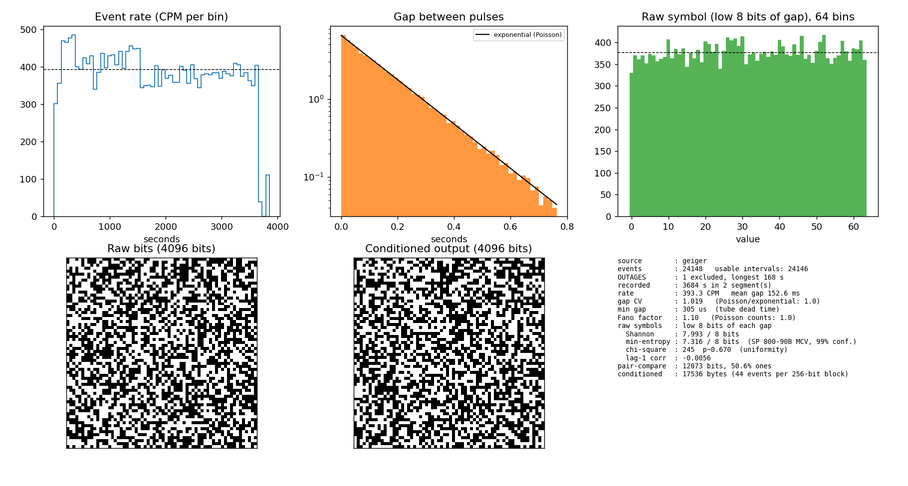

# Capture analysis: geiger-20261012-193342

Real hardware capture (RadiationD-v1.1 CAJOE, M4011 tube, weak source near the tube) on an Arduino Mega, 0.5 µs timestamps.
Started 2026-10-12 19:33:42 local. Raw data: `geiger-20261012-193342.csv` (not tracked by git). Figure: `geiger-20261012-193342.png`.



## Verdict

The low bits of the pulse gaps are statistically uniform and independent, and the SHA-256 conditioned output passes every statistical test that has enough data to run. One goodness-of-fit test against a perfect exponential shows a small, stable deviation, which does not affect the output (see *Known deviation*).

## Capture summary

| | |
|---|---|
| Events | 24,148 (24,146 usable intervals) |
| Recorded time | 3,684 s (61.4 min) in 2 segments, plus one 168 s excluded outage |
| Rate | 393 CPM (mean gap 152.6 ms); 373-422 CPM across deciles, higher in the first ~400 s |
| Minimum gap | 305 µs (tube dead time) |
| Firmware | first version (event numbers assigned by the host, no `start=` header) |

### The outage

The laptop slept at device time 3,666.6 s. The Mega's clock kept running, but 168 s of events never reached the file and, because the host numbered events itself, the loss left no gap in `seq`. The analysis excludes it automatically (any gap longer than 20x the typical gap is split out and reported as an `OUTAGE`). The 119 events after the wake-up are ordinary data. Dropping them, or dropping the higher-rate first 400 s, changes none of the conclusions:

| Dataset | Events | CV | Fano | KS D | MCV min-entropy | chi² p |
|---|---|---|---|---|---|---|
| All | 24,146 | 1.019 | 1.10 | 0.0096 | 7.32 | 0.67 |
| Before the sleep only | 24,028 | 1.019 | 1.07 | 0.0095 | 7.31 | 0.72 |
| Minus first 400 s | 21,327 | 1.014 | 1.05 | 0.0099 | 7.31 | 0.89 |

Firmware and `capture` were fixed afterwards: the Mega now numbers every pulse in the interrupt handler, so any loss shows up as a `seq` gap. Use `systemd-inhibit --what=sleep:idle` to stop the laptop sleeping during a run.

## Source: is it Poisson?

| Check | Result | Ideal |
|---|---|---|
| Gap coefficient of variation | 1.019 | 1.0 |
| Fano factor, 5x / 10x / 20x / 50x mean-gap windows | 1.06 / 1.10 / 1.16 / 1.43 | 1.0 |
| Rate by decile (CPM) | 415 421 404 422 387 379 376 373 386 377 | flat |
| KS vs exponential (Monte-Carlo p) | D = 0.0096, p < 0.01 | p > 0.01 |

Short-window behaviour is Poisson. The Fano factor rising with window size shows slow rate drift (about 10%, highest early on).

### Known deviation

The KS test rejects a perfect exponential. D = 0.0096 means the empirical and fitted CDFs differ by under 1% at most; at 24,000 events the test is simply very sensitive. Removing slow drift (D = 0.0090), the post-sleep events, or the first 400 s does not remove it. Likely contributors are tube dead-time recovery and pulse-line ringing / double-triggering (the first capture showed clusters of gaps at ~40 µs and ~310 µs). We decided to ignore it: a smooth 1% distortion of the gap distribution cannot bias the low 8 bits, which span only 128 µs, and every low-bit test below is clean. Confirm with a scope, or a short-gap filter, if it ever matters.

## Raw symbols: low 8 bits of each gap (24,146 symbols)

| Check | Result |
|---|---|
| Shannon entropy | 7.993 / 8 bits |
| Min-entropy (SP 800-90B MCV, 99% conf.) | 7.32 / 8 bits |
| Same estimator on ideal uniform data, same n | 7.32 bits (the estimate is sample-size limited) |
| First half / second half MCV | 7.12 / 7.16 |
| Uniformity chi-square | 245, p ≈ 0.67 |
| Per-bit P(1), bits 0-7 | 0.502 0.501 0.494 0.499 0.504 0.506 0.506 0.502 (worst z = +1.97) |
| Autocorrelation z, lags 1-8 | -0.9 -0.7 +0.1 +1.8 0.0 +0.3 -0.6 -1.7 |
| zlib compression ratio | 1.0007 |

Min-entropy by number of bits used per gap:

| k bits | Shannon | MCV | % of k |
|---|---|---|---|
| 2 | 2.00 | 1.94 | 97% |
| 4 | 4.00 | 3.83 | 96% |
| 6 | 6.00 | 5.66 | 94% |
| 8 | 7.99 | 7.32 | 91% |
| 10 | 9.97 | 8.71 | 87% |
| 12 | 11.87 | 9.47 | 79% |

The percentage falls with k only because 24,000 samples cannot populate 4,096 symbols; it is an estimator limit, not a source limit.

## Conditioned output

SHA-256 over 44 symbols (320 bits of credited min-entropy) per 256-bit block: 548 blocks, 17,536 bytes, from 24,112 events.

| Check | Result |
|---|---|
| Monobit | 50.02% ones, z = +0.13 |
| Runs | z = +0.24 |
| Byte chi-square | 273, p ≈ 0.21 |
| Byte lag-1 correlation | z = +1.04 |
| zlib ratio | 1.0009 |
| Duplicate 32-byte blocks | 0 |

## NIST SP 800-22 (dj-on-github/sp800_22_tests)

Run with `./qrng.py nist22 FILE` (conditioned, 140,288 bits) and `--raw` (193,168 bits).

| Test | Conditioned | Raw |
|---|---|---|
| monobit | 0.894 PASS | 0.114 PASS |
| frequency within block | 0.288 PASS | 0.321 PASS |
| runs | 0.806 PASS | 0.032 PASS |
| longest run of ones | 0.444 PASS | 0.221 PASS |
| binary matrix rank | 0.789 PASS | 0.372 PASS |
| DFT (spectral) | 0.628 PASS | 0.298 PASS |
| non-overlapping template (20 random templates, median P) | 0.627 PASS, 0 failed | 0.686 PASS, 0 failed |
| serial (min of 2) | 0.972 PASS | 0.092 PASS |
| approximate entropy | 0.980 PASS | 0.090 PASS |
| cumulative sums (min of 2) | 0.753 PASS | 0.064 PASS |
| overlapping template | skipped (needs 1,028,016 bits) | skipped |
| Maurer's universal | skipped (needs 387,840 bits) | skipped |
| linear complexity | skipped (needs 1,000,000 bits) | skipped |
| random excursions | skipped: 250 walk cycles, needs ≥ 500 | skipped: 167 cycles |
| random excursions variant | skipped: 250 walk cycles | skipped: 167 cycles |

10 of 15 tests ran and all passed on both streams. The other five cannot run validly at this length; they need about 1,028,016 bits, roughly 129,000 conditioned bytes, which is about 177,000 events (about 7.5 hours at 393 CPM). The suite itself reports "not enough bits" as FAIL; `qrng.py nist22` relabels these as SKIPPED. The suite's template test draws a single random template per call, so one P is a 1-in-100 lottery (one such draw gave 0.0089 during development); the command repeats it 20 times and judges the proportion.

## Not done / next steps

- NIST SP 800-90B (`ea_non_iid` on `generate FILE --raw`): only the single MCV estimator was used here.
- The five skipped SP 800-22 tests, and dieharder / PractRand, need the overnight run (about 177,000+ events).
- The gap-distribution deviation was not traced to a hardware cause.

## Reproduce

```
./qrng.py analyze data/geiger-20261012-193342.csv --full --png data/geiger-20261012-193342.png
./qrng.py nist22  data/geiger-20261012-193342.csv            # needs the suite cloned, see README
./qrng.py nist22  data/geiger-20261012-193342.csv --raw
```
