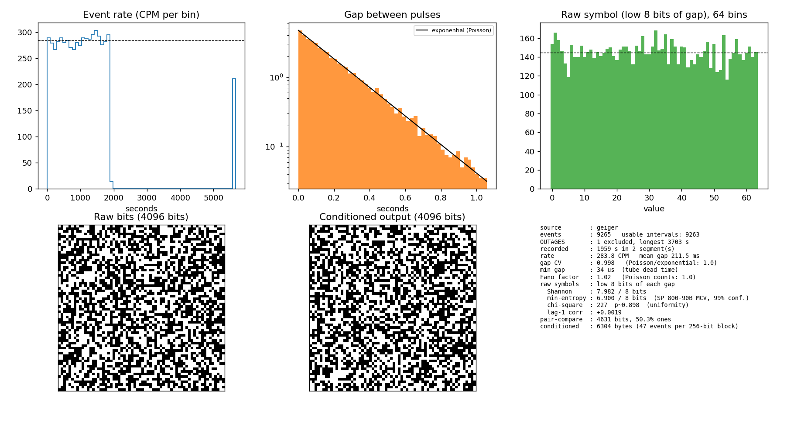

# Analysis: geiger-20261012-232429

Generated 2026-10-13 00:59 by `qrng.py` from `geiger-20261012-232429.csv` (low 8 bits of each gap).



## Flags

- 1 outage gap(s) excluded, longest 3703 s (lost events or laptop sleep).

## Summary

```
source        : geiger
events        : 9265   usable intervals: 9263
OUTAGES       : 1 excluded, longest 3703 s
recorded      : 1959 s in 2 segment(s)
rate          : 283.8 CPM   mean gap 211.5 ms
gap CV        : 0.998   (Poisson/exponential: 1.0)
min gap       : 34 us  (tube dead time)
Fano factor   : 1.02   (Poisson counts: 1.0)
raw symbols   : low 8 bits of each gap
  Shannon     : 7.982 / 8 bits
  min-entropy : 6.900 / 8 bits  (SP 800-90B MCV, 99% conf.)
  chi-square  : 227  p~0.898  (uniformity)
  lag-1 corr  : +0.0019
pair-compare  : 4631 bits, 50.3% ones
conditioned   : 6304 bytes (47 events per 256-bit block)
```

## Detailed checks

```
=== 1. Is the source Poisson? ===
KS vs exponential : D=0.0057  Monte-Carlo p=0.86
rate by decile CPM: 280 282 281 274 278 286 290 291 285 293   (spread 274-293)
KS after removing slow rate drift (20 blocks): D=0.0054  Monte-Carlo p=0.91
Fano vs window    : 5x:1.00  10x:1.02  20x:0.98  50x:1.04

=== 2. Raw symbol quality (low 8 bits of each gap) ===
per-bit P(1)      : b0:0.497 b1:0.493 b2:0.500 b3:0.496 b4:0.492 b5:0.498 b6:0.498 b7:0.496
  worst bit z     : -1.44
autocorr z, lag1-8: +0.2 +0.3 -0.6 +1.0 +0.9 -0.8 -0.2 +0.3
zlib ratio        : 1.0012  (random ~1.00; <1.00 means structure)
min-entropy vs k (MCV, 99% conf.):
  k=2   Shannon  2.00  MCV  1.91  (  96% of 2)
  k=4   Shannon  4.00  MCV  3.75  (  94% of 4)
  k=6   Shannon  6.00  MCV  5.49  (  92% of 6)
  k=8   Shannon  7.98  MCV  6.90  (  86% of 8)
  k=10  Shannon  9.92  MCV  8.20  (  82% of 10)
  k=12  Shannon 11.65  MCV  9.11  (  76% of 12)
ideal uniform, same n: MCV 6.97 at k=8   (estimator is sample-size limited)
first/second half : MCV 6.80 / 6.68

=== 3. Conditioned output ===
bytes             : 6304 from 9259 events (47 per block, 197 blocks)
monobit           : 50.29% ones, z=+1.29
runs test         : z=+0.02
byte chi-square   : 251  p~0.557
byte lag-1 corr z : -1.62
zlib ratio        : 1.0017
duplicate blocks  : 0

For authoritative min-entropy run NIST ea_non_iid on `generate --raw`; for the output use dieharder/PractRand.
```

## NIST SP 800-22 (conditioned output)

```
conditioned output: 6304 bytes = 50432 bits (source: geiger)
test                                            min P  result
monobit_test                                   0.1966  PASS
frequency_within_block_test                    0.2816  PASS
runs_test                                      0.9799  PASS
longest_run_ones_in_a_block_test               0.4364  PASS
binary_matrix_rank_test                        0.4565  PASS
dft_test                                       0.1672  PASS
non_overlapping_template_matching_test         0.4026  PASS (20 random templates, 0 failed, median P shown)
overlapping_template_matching_test                  -  SKIPPED (not enough bits: Insufficient data. 50432 bit provided. 1,028,016 bits requir)
maurers_universal_test                              -  SKIPPED (not enough bits: Error. Need at least 387840 bits. Got 50432.)
linear_complexity_test                              -  SKIPPED (not enough bits: Error. Need at least 10^6 bits)
serial_test                                    0.4386  PASS (2 sub-tests)
approximate_entropy_test                       0.4571  PASS
cumulative_sums_test                           0.1697  PASS (2 sub-tests)
random_excursion_test                               -  SKIPPED (invalid: only 154 walk cycles, NIST needs >= 500)
random_excursion_variant_test                       -  SKIPPED (invalid: only 154 walk cycles, NIST needs >= 500)

10 pass, 5 skipped
Pass threshold is P >= 0.01, so even perfect data fails ~1% of sub-tests; judge by the pattern, not one P.
Skipped tests need ~1,000,000 bits; capture longer (or pool captures) to run them.
```

## Files

- `geiger-20261012-232429.png` figure
- `geiger-20261012-232429.hex` conditioned random output, one 32-byte block per line
- `geiger-20261012-232429.raw` unconditioned 8-bit symbols, one per byte
- `geiger-20261012-232429.md` this report
